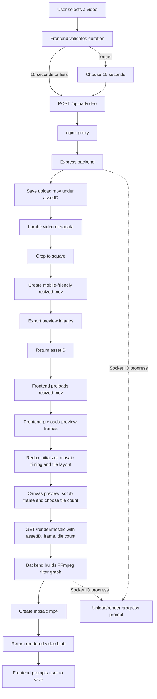

# Mosaic

- Mosaic is a web app for creating social media friendly video edits.
- Mosaic is a port of the popular native app, [Cine-pic](https://apps.apple.com/us/app/cine-pic-photo-video-montage/id923762113).

[https://github.com/user-attachments/assets/e5b8cb93-94c7-41e8-8b78-3eb70b540e53](https://github.com/user-attachments/assets/b4eefe15-9676-4c4f-a6fa-08cd964e05bd
)

## Project Organization
Mosaic is Docker-based and the project is organized by container:
- `/mosaic-backend` (Express + FFmpeg)
- `/mosaic-frontend` (React + TypeScript)
- `/mosaic-proxy` (nginx reverse proxy)

## Application Logic Flow
Mosaic turns a short user-uploaded video into a square, social-media-friendly mosaic edit. The frontend owns the upload, edit, and save experience with React and Redux. The backend owns durable upload storage, FFmpeg processing, frame extraction, and final video rendering.



### Frontend Flow
The React app renders three main modes through navigation state: upload, edit, and save. Upload actions are handled by Redux async thunks that validate the selected file, send it to the backend, preload the optimized video, and preload the exported frame images. Once those assets are ready, the mosaic slice calculates tile timing, copy areas, draw areas, and animation events.

During editing, the scrubber chooses the background frame and the mosaic selector chooses the tile count. `MosaicTiles` uses a canvas animation preview so the user can see the selected mosaic layout before rendering.

### Backend Flow
The Express backend exposes two primary routes:
- `POST /uploadvideo` saves the upload, probes it with ffprobe, crops it square, creates a lightweight resized video, exports preview images, and returns an `assetID`.
- `GET /render/mosaic` accepts the `assetID`, selected scrubber frame, and tile count, then builds an FFmpeg filter graph to render the final mosaic `.mp4`.

FFmpeg progress is emitted over Socket.IO so the frontend prompt can show upload and render status.

FFmpeg work goes through one queue, so the server only runs as many uploads and renders at once as its memory allows. Others wait up to 25 seconds, then get a "server is busy" message. Uploads, renders and failure reports are also rate limited per visitor. The defaults suit most servers; these optional backend environment variables change them:
- `FFMPEG_MAX_JOBS`: uploads and renders processed at once (default: worked out from memory and cores, up to 4)
- `FFMPEG_THREADS`: threads per FFmpeg run (default 2)
- `FFMPEG_MAX_WAITING` and `FFMPEG_MAX_WAIT_MS`: how many requests may wait, and for how long (defaults 8 and 25000)
- `TRUST_PROXY_HOPS`: proxies in front of the backend that add to `X-Forwarded-For`, used to find each visitor's address (default 2: the load balancer and nginx)


## Running Locally
```
git clone https://github.com/patrick-s-young/mosaic.mobi.git
cd mosaic.mobi/mosaic-backend
npm install
cd ../mosaic-frontend
npm install
```


To build images and run containers, run `docker compose -f docker-compose-dev.yaml up` from the root directory.

To update just the UI, run `npm run dev` from the `/mosaic-frontend` directory. Note: you will not be able to upload or render new videos.

To update the UI with upload and render enabled, run `docker compose -f docker-compose-frontend-dev.yaml up` from the root directory.

To run the containers on Docker Hub, run `docker compose up` from the root directory.

## Author

* **Patrick Young** - [Patrick Young](https://www.linkedin.com/in/patrick-s-young/)

## License

This project is licensed under the MIT License - see the [LICENSE](LICENSE) file for details.
